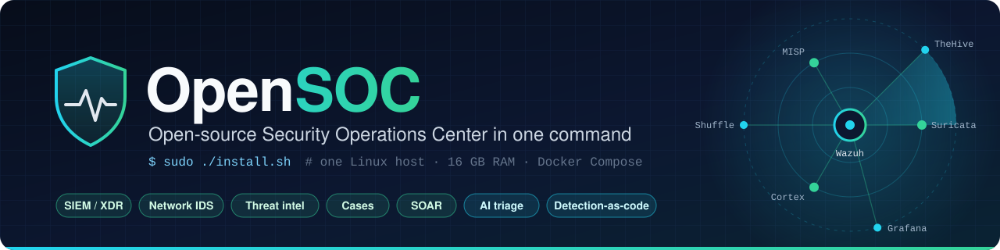
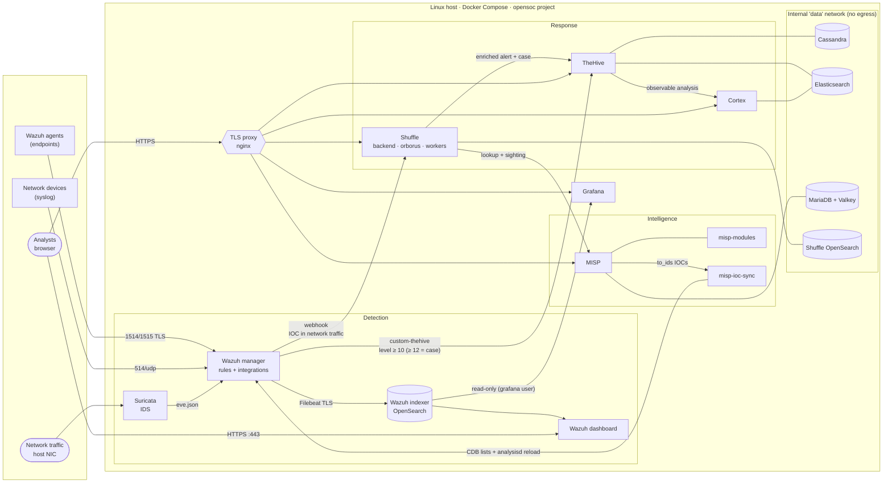

<p align="center">
  
</p>

# OpenSOC

Open-source SOC (Security Operations Center) that deploys **with a single command on a single 16 GB RAM Linux machine**. It brings together detection (SIEM/XDR + network IDS), threat intelligence, case management, analysis, orchestration (SOAR) and dashboards, already integrated with each other.

```bash
git clone https://github.com/0x0128/opensoc.git
cd opensoc/infra
sudo ./install.sh     # checks requirements, generates secrets, starts and configures everything
sudo ./verify.sh      # confirms that every service and integration responds
```

## Components

| Component | Role | Image | Access |
|---|---|---|---|
| **Wazuh** 4.14.9 (manager, indexer, dashboard) | SIEM/XDR: agents, rules, alerts | `wazuh/wazuh-*` | `https://<host>` (443), API 55000, agents 1514/1515, syslog 514/udp |
| **Suricata** 8.0.8 | Network IDS on the host NIC (AF_PACKET) | `jasonish/suricata` | — (feeds Wazuh) |
| **TheHive** 5.8.1 | Alert and case management | `strangebee/thehive` | `https://<host>:9000` |
| **Cortex** 4.1.0 | Analyzers and responders for TheHive | `thehiveproject/cortex` | `https://<host>:9001` |
| **MISP** 2.5 (+ misp-modules) | Threat intelligence platform (IOCs) | `nukib/misp` | `https://<host>:8443` |
| **Shuffle** | SOAR: playbooks | `frikky/shuffle` | `https://<host>:3443` |
| **Grafana** 13.2 | Dashboards over the Wazuh alerts | `grafana/grafana` | `https://<host>:3000` |

Supporting services: Cassandra 4.1 and Elasticsearch 8.19 (TheHive/Cortex), MariaDB 11.8 and Valkey 8.1 (MISP), OpenSearch 2.19 (Shuffle), `misp-ioc-sync` (MISP → Wazuh) and an nginx TLS proxy in front of the web interfaces.

Every image is pinned by version or by *digest* and is pulled from Docker Hub. MISP uses the [NÚKIB](https://github.com/NUKIB/misp) image (the Czech national cybersecurity agency: AlmaLinux-based, hardened, production-oriented) and Shuffle its official `frikky/shuffle` images. Shuffle's OpenSearch reuses the Wazuh indexer image (OpenSearch 2.19) with security disabled on an internal network, to avoid pulling and maintaining a second OpenSearch.

## Architecture



### Integrations

| Flow | How it works |
|---|---|
| **Suricata → Wazuh** | Suricata writes EVE JSON to a shared volume that the manager reads (JSON `localfile`). The Wazuh rules (`0475-suricata_rules.xml`) plus the OpenSOC rules raise the level according to the Suricata severity (severity 1 → level 10, severity 2 → level 7). |
| **Wazuh → TheHive** (alerts to cases) | `custom-thehive` integration (`infra/config/wazuh/integrations/`): every alert with level ≥ `THEHIVE_ALERT_LEVEL` (10) is created as a TheHive alert with its observables (IPs, domains, hashes, host…), tags and MITRE technique; if the level is ≥ `THEHIVE_CASE_LEVEL` (12) it is **automatically promoted to a case**. |
| **MISP → Wazuh** (IOCs) | Every `MISP_SYNC_INTERVAL` s, `misp-ioc-sync` exports the `to_ids` attributes (IPs, domains, hashes; last `MISP_IOC_MAX_AGE`) to the `etc/lists/malicious-ioc/*` CDB lists used by the Wazuh IOC ruleset, and reloads `analysisd` through the API only when they change. The `opensoc_rules.xml` rules (100100-100106) raise those matches to level 12-14 with the `misp_ioc` group. |
| **Wazuh → Shuffle** (SOAR) | IOC matches in network traffic (`misp_ioc_network` group) trigger the sample playbook **OpenSOC - MISP IOC triage** (`infra/config/shuffle/workflows/`): it looks the indicator up in MISP, records a *sighting* in MISP, creates an enriched alert in TheHive and turns it into a case. |
| **TheHive ↔ Cortex** | `install.sh` creates the organization and the service user in Cortex, and registers Cortex in TheHive (`/api/v1/admin/config/cortex`). Analyzers run as sibling containers. |
| **Grafana ← Wazuh** | Elasticsearch datasource provisioned against the indexer (read-only `grafana` user) and the **OpenSOC - Overview** dashboard. |

## Requirements

| | Minimum | Notes |
|---|---|---|
| OS | Linux x86_64 (Ubuntu 22.04/24.04, Debian 12, RHEL/Alma/Rocky 9…) | Run as `root` (`sudo`) |
| RAM | 16 GB | At rest the stack uses ~9-10 GiB (measured: 8.7 GiB without vulnerability detection); with less than 14 GiB the installer stops |
| CPU | 4 cores | 8 recommended with heavy traffic or many agents |
| Disk | 40 GB free in the Docker directory (60 GB recommended) | ~15 GB of images + data; Wazuh vulnerability detection needs ~15 GB more on first start (`WAZUH_VULNERABILITY_DETECTION=no` disables it) |
| Software | Docker Engine ≥ 24, Docker Compose v2 ≥ 2.24, `curl`, `openssl`, `jq` | `git` is optional (pre-download of Shuffle apps) |
| Network | Free ports: 443, 55000, 9000, 9001, 8443, 3443, 3000, 1514, 1515, 514/udp | Configurable in `infra/.env` |
| Kernel | `vm.max_map_count ≥ 262144` | The installer sets it and persists it in `/etc/sysctl.d/99-opensoc.conf` |

Images are pulled from Docker Hub. Internet egress is needed for Suricata to update its rules (ET Open), for MISP to download feeds and for Cortex to fetch its analyzer catalog; without it OpenSOC still works with the local rules.

## Installation

```bash
git clone https://github.com/0x0128/opensoc.git
cd opensoc/infra
sudo ./install.sh
```

The installer is **idempotent** (it can be run as many times as you like) and performs:

1. **Requirements**: Linux, root, Docker/Compose, RAM, CPU, disk, free ports and `vm.max_map_count`.
2. **Secrets**: creates `infra/.env` (mode 600, ignored by git) from `infra/.env.example`, generating random passwords and keys and detecting the host IP and the Suricata interface. On later runs it keeps the existing values and only adds new keys.
3. **PKI**: creates its own root CA (`infra/generated/certs/root-ca.pem`) and the certificates for the indexer, manager, dashboard and TLS proxy.
4. **Configuration**: generates the indexer users (bcrypt hash; the demo users are removed), `ossec.conf` and the agent enrollment password.
5. **Start-up**: `docker compose pull` + `up -d` and waits until every *healthcheck* is green.
6. **Integrations**: initializes Cortex (superadmin, organization, API key), TheHive (changes the default password, creates the organization, users and integration key, registers Cortex), MISP (admin credentials, automation user, free feeds) and Shuffle (imports the playbook and enables its webhook); then applies the keys in Wazuh.
7. **Summary** with the access URLs.

Options: `--no-pull` (use local images), `--skip-checks` (do not abort on requirements), `--help`.

### Verification

```bash
sudo ./verify.sh          # services + end-to-end integrations
sudo ./verify.sh --quick  # services only
```

`verify.sh` checks that every container is healthy and that every service answers with real authentication (TLS validated against the OpenSOC CA), and then runs end-to-end tests:

- **Wazuh → TheHive**: injects a synthetic event through the Wazuh API (rule 100299, level 12) and waits for the alert in the indexer and the alert + case in TheHive.
- **Suricata → Wazuh → TheHive**: sends a test UDP datagram to `198.51.100.78` (RFC 5737 documentation address) that Suricata detects (sid 9000001) and that must reach Wazuh (rule 100200) and TheHive.
- **MISP → Wazuh**: creates (once) the *OpenSOC self-test IOC* event in MISP with `198.51.100.77`, synchronizes and checks the Wazuh CDB list.
- **Wazuh → Shuffle → MISP/TheHive**: sends the probe to the IOC IP and checks that the playbook recorded the *sighting* in MISP and created the alert and the case in TheHive.

It exits with code 0 only if everything passes.

## Access

| Service | URL | User | Password (`infra/.env`) |
|---|---|---|---|
| Wazuh dashboard | `https://<host>` | `admin` | `WAZUH_INDEXER_PASSWORD` |
| TheHive | `https://<host>:9000` | `analyst@opensoc.local` (OpenSOC org.) · `admin@thehive.local` (platform) | `THEHIVE_ANALYST_PASSWORD` · `THEHIVE_ADMIN_PASSWORD` |
| Cortex | `https://<host>:9001` | `admin` | `CORTEX_ADMIN_PASSWORD` |
| MISP | `https://<host>:8443` | `admin@opensoc.local` | `MISP_ADMIN_PASSWORD` |
| Shuffle | `https://<host>:3443` | `admin` | `SHUFFLE_ADMIN_PASSWORD` |
| Grafana | `https://<host>:3000` | `admin` | `GRAFANA_ADMIN_PASSWORD` |
| Wazuh API | `https://<host>:55000` | `wazuh-wui` | `WAZUH_API_PASSWORD` |

`<host>` is `OPENSOC_HOSTNAME` (by default, the IP of the main interface). Import `infra/generated/certs/root-ca.pem` as a trusted CA in your browser to avoid certificate warnings.

### Connecting Wazuh agents

```bash
# On the endpoint (Linux, wazuh-agent 4.14.x package)
sudo WAZUH_MANAGER="<host>" WAZUH_REGISTRATION_PASSWORD="<WAZUH_ENROLLMENT_PASSWORD>" \
     apt-get install wazuh-agent
sudo systemctl enable --now wazuh-agent
```

## Operations

From `infra/` (the commands pick up `infra/.env` automatically):

```bash
docker compose ps                      # service status and health
docker compose logs -f wazuh.manager   # logs of one service
docker compose stop                    # stop (data is kept in volumes)
docker compose start                   # start again
sudo ./install.sh                      # re-apply configuration / repair
docker compose down -v                 # DELETE everything, including the data
```

- **Integration logs**: `docker compose exec wazuh.manager tail -f /var/ossec/logs/integrations.log` (TheHive) and `docker compose logs misp-ioc-sync`.
- **Settings**: TheHive forwarding levels (`THEHIVE_ALERT_LEVEL`, `THEHIVE_CASE_LEVEL`), IOC interval and age (`MISP_SYNC_INTERVAL`, `MISP_IOC_MAX_AGE`), ports and memory (`*_HEAP`, `*_MEM_LIMIT`) in `infra/.env`; then `sudo ./install.sh`.
- **Custom rules**: `infra/config/wazuh/rules/opensoc_rules.xml` (Wazuh) and `infra/config/suricata/rules/opensoc.rules` (Suricata).
- **Backups**: `infra/.env`, `infra/generated/` and the `opensoc_*` Docker volumes.

### Memory profile (16 GB)

| Service | JVM heap | Limit |
|---|---|---|
| Wazuh indexer | 1 GB | 2 GB |
| Wazuh manager / dashboard | — | 1.5 GB / 1 GB |
| Cassandra | 1 GB | 2 GB |
| Elasticsearch (TheHive/Cortex) | 768 MB | 1.5 GB |
| TheHive | 1 GB | 2 GB |
| Cortex | 512 MB | 1 GB |
| MISP (+ MariaDB, Valkey, modules) | — | 1.5 GB (+0.75 / 0.25 / 0.5 GB) |
| Shuffle (OpenSearch + backend) | 512 MB | 1.25 GB + 0.75 GB |
| Suricata | — | 1 GB |
| Grafana, proxy, sync, frontend, orborus | — | ~1 GB in total |

The limits are ceilings, not reservations: the measured consumption at rest is ~8.7 GiB (Wazuh indexer 1.4 · TheHive 1.6 · Cassandra 1.3 · Elasticsearch 1.2 · Shuffle OpenSearch 0.9 GiB; everything else < 0.5 GiB each).

### Notes on Shuffle

- Orborus runs in classic mode (one `worker-<id>` container per execution, plus the app containers). Shuffle's `run`/`swarm` mode would turn the host into a Docker Swarm node and publish the worker ports on every interface, so it is disabled; the Tenzir *pipelines* node is disabled too (it would take Wazuh's port 1514).
- The core containers are named `shuffle-backend`, `shuffle-frontend` and `shuffle-orborus` (fixed names): Orborus' orphan-container cleanup spares names that start with `shuffle`.
- Workers and apps are created by Orborus and do not belong to the Compose project: after `docker compose down`, remove them with `docker rm -f $(docker ps -aq --filter name=worker- --filter name=http_ --filter name=shuffle-tools_)`.

## Security

- No secret lives in the repository: all of them are generated in `infra/.env` (mode 600, in `.gitignore`), as are the PKI (`infra/generated/`) and the data (`infra/data/`).
- Every web interface is served over HTTPS with certificates from the OpenSOC CA; the indexer only listens on `127.0.0.1`.
- The databases sit on the internal Docker network `opensoc_data` (no Internet egress and no published ports).
- The default passwords of TheHive, Cortex, MISP, Wazuh and Grafana are changed; agent enrollment requires a password.
- Things to harden in production: restrict `OPENSOC_BIND_ADDRESS`/the firewall to the management network, replace the certificates with ones from your own PKI, and keep in mind that Cortex and Shuffle use the host's Docker socket (required to run analyzers and apps).

## Layout

```
.
├── README.md
├── assets/banner.svg               # README banner
├── .github/workflows/ci.yml        # compose validation, shellcheck, yamllint, JSON/XML/Python
└── infra/
    ├── docker-compose.yml          # full stack with healthchecks and memory limits
    ├── install.sh                  # idempotent installer
    ├── verify.sh                   # service and integration verification
    ├── .env.example                # configuration template (no secrets)
    ├── lib/common.sh               # shared helpers
    └── config/
        ├── wazuh/                  # ossec.conf, OpenSOC rules, TheHive integration, indexer
        ├── suricata/               # launcher, overrides and local rules
        ├── thehive/ cortex/        # additional configuration
        ├── misp-sync/              # MISP -> Wazuh CDB lists exporter
        ├── shuffle/workflows/      # sample playbook
        ├── shuffle-opensearch/     # Shuffle's OpenSearch
        ├── grafana/                # provisioned datasource and dashboard
        └── proxy/                  # nginx TLS
```

## Troubleshooting

| Symptom | What to check |
|---|---|
| A service never becomes *healthy* | `docker compose ps` and `docker compose logs <service>`; on first start some take 5-10 min. |
| The indexer does not start | `sysctl vm.max_map_count` (≥ 262144) and free RAM. |
| Suricata sees no traffic | `SURICATA_INTERFACE` in `infra/.env` must be the NIC that receives the traffic (or a mirror/SPAN port). |
| No alerts reach TheHive | `/var/ossec/logs/integrations.log` on the manager; the `THEHIVE_INTEGRATION_API_KEY` key is regenerated with `sudo ./install.sh`. |
| `toomanyrequests` errors while pulling | Docker Hub rate limit: wait, or run `docker login` and repeat `sudo ./install.sh`. |
| Shuffle has no apps | The backend downloads the apps from GitHub; if the host has no access, copy `Shuffle/python-apps/{http,shuffle-tools}` into `infra/data/shuffle-apps/`. |
| The Wazuh manager does not apply `ossec.conf` changes | The image only copies `/wazuh-config-mount` when the container is created: `sudo ./install.sh` recreates it automatically when it detects changes. |
| `rlimit`/`operation not permitted` at start-up (nested containers, LXC) | Lower `OPENSOC_NOFILE` in `infra/.env` to the host's open-files limit. |

## CI

`.github/workflows/ci.yml` validates on every push/PR:

- `docker compose config` with `infra/.env.example` (syntax, interpolation and compose references).
- `shellcheck` on every script.
- `yamllint`, validity of the JSON files (playbook, Grafana dashboard), XML (rules and `ossec.conf` template) and compilation of the Python scripts.

## Licenses

OpenSOC (the files in this repository) is distributed under the MIT license (`LICENSE`). Each component keeps its own license: Wazuh (GPLv2), Suricata (GPLv2), MISP (AGPLv3), Cortex (AGPLv3), Shuffle (AGPLv3), Grafana (AGPLv3), OpenSearch (Apache 2.0), Cassandra (Apache 2.0). **TheHive 5** is not open source: its free *Community* edition is used under the StrangeBee license, and Elasticsearch 8 is distributed under the Elastic License/SSPL/AGPLv3.
